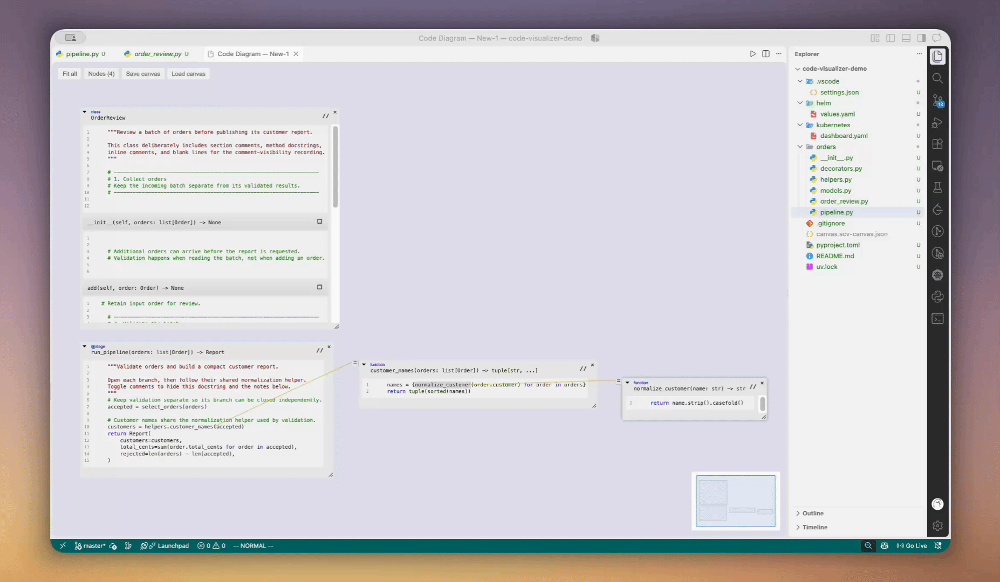
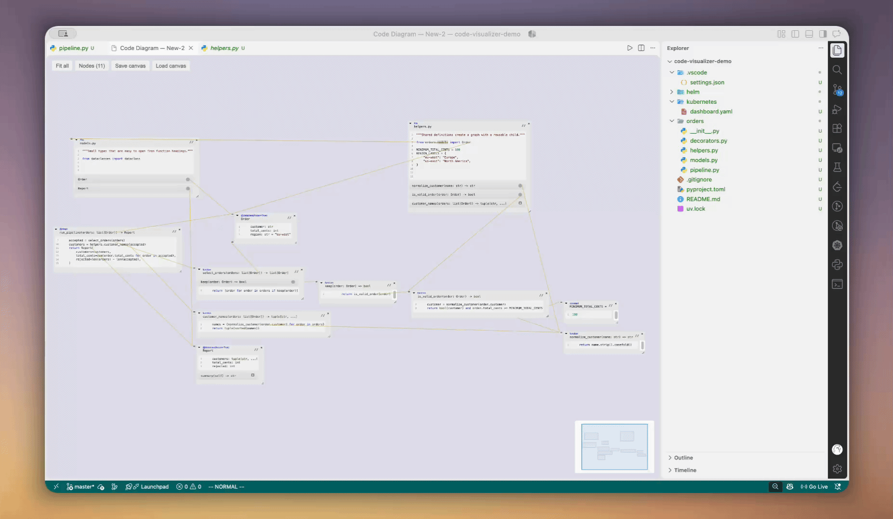

# Source Code Visualizer

Explore code and YAML as connected, on-demand diagrams inside VS Code.

**This project is an independently maintained fork of [DarkTrick/SourceCodeVisualizer](https://github.com/DarkTrick/SourceCodeVisualizer).** The original project provides the foundation. This fork builds on it with replacement declaration parsers, YAML visualization, more precise source navigation, comment controls, and reusable canvas workspaces.

The recordings below show this fork—not the original Marketplace release.

## Language support and parsing

Definition detection finds the symbol or source you want to explore. The parser component extracts its structure and source ranges for the diagram. They are separate responsibilities.

| Language | Definition detection | Parser component | Status |
| --- | --- | --- | --- |
| Python, YAML | **Python:** VS Code Python tooling / Pylance; select your project's interpreter.<br>**YAML:** Dedicated structure and alias/anchor lookup; no external YAML language server required. | **Python:** Bundled Lezer Python (`@lezer/python`) and dedicated adapter.<br>**YAML:** Bundled `yaml` AST/CST parser and dedicated source mapping. | **Supported.** Python is the primary code validation target; YAML support covers configuration structure, not Helm execution or Kubernetes dependency analysis. |
| JavaScript, TypeScript | VS Code 1.146+ built-in JavaScript/TypeScript language provider. | Bundled TypeScript **6.0.3** syntax parser (`typescript-parser`); `.js/.mjs/.cjs`, `.ts/.mts/.cts` and `.d.ts/.d.mts/.d.cts`. | **Supported.** Modern declarations, variables, callbacks and cross-family definition navigation; semantic targets remain the language provider's authority. |
| TSX | VS Code's built-in TypeScript language provider. | Bundled TypeScript **6.0.3** in TSX mode. | **Experimental.** Not certified by the JS/TS support scope. |
| C, C++, Java, PHP, Dart | An installed language provider for the relevant language exposing VS Code symbols and definitions. | Inherited generic brace/semicolon heuristics, **not language-specific syntax parsers**. | **Legacy / best effort.** No fork-level support validation; C/C++ has known parsing limitations. |

This fork replaces legacy declaration-boundary heuristics with syntax-aware parsing for Python and JavaScript/TypeScript/TSX. For code, the bundled parsers **do not replace Pylance or the language server**.

**Supported** means actively maintained and tested scenarios, not a guarantee for every syntax form or project. **Experimental** has targeted tests without Python-level validation. **Legacy / best effort** adapters remain available, but can produce extraction errors or incorrect boundaries; their presence is not a promise of reliable support. Languages not listed have no bundled adapter.

## See it in action

### 1. Explore code without losing the trail

Start with a function or a whole file, then follow the definitions you want to understand.

- Follow calls across files and reuse an already-open definition.
- Navigate from type names in headings and from supported decorator metadata.
- Explore classes, nested functions, variables, constants, and imported modules.
- Use **Show in code** to return to the original source.


### 2. Show the explanation—or just the code

The **Comments** button toggles comments and Python docstrings for each node. Comment-only blocks and blank gaps compact when hidden, while source navigation retains its original coordinates.

Diagram source is read-only. Make code changes in the source editor.



### 3. Build, organize, and revisit a canvas

Choose **New canvas** or an existing canvas when visualizing from the editor or Explorer.

- Select and move nodes together; use **Nodes** to jump to an existing window.
- Pan, zoom, resize, collapse, and use **Fit all** to frame your exploration.
- Close a branch without removing descendants still shared by another branch.
- **Save canvas** to JSON, then **Load canvas** into a separate tab with its layout and relationships restored.



### 4. Explore YAML configuration

Open a Kubernetes manifest or Helm values file and expand its structure instead of reading one long document.

- Navigate mappings, sequences, collection items, and multiple YAML documents.
- Retain scalar settings and multiline values alongside child containers.
- Follow YAML aliases to their anchors, including scalar anchors.
- Return to the original YAML with **Show in code**.

This is source-structure navigation—not Kubernetes dependency discovery or Helm template execution. Raw Go-template expressions are not YAML.


## Install and get started

This fork is named **Source Code Visualizer (Fork)**, with extension ID `itnccuong.source-code-visualizer`. The [original Code Visualizer Marketplace listing](https://marketplace.visualstudio.com/items?itemName=visualprogrammingx.SourceCodeVisualizer) installs upstream, not this fork's additions.

Install this fork's built `.vsix` through **Extensions → … → Install from VSIX…**. To build it yourself, see [Development](#development).

Disable or uninstall the previous **Source Code Visualizer (Local)** build before installing this release.

1. Open your project in VS Code and enable its language tooling.
2. Put the cursor on a declaration or identifier, then right-click → **Visualize This**.
3. Choose a new or existing canvas.
4. Double-click source identifiers, or use **F12**, to continue exploring.

To start from a whole file, right-click it in Explorer → **Visualize This**. The Command Palette also provides **Visual Programming: Visualize File** and **Visual Programming: Load from Canvas**.

## Canvas controls

| Action | Control |
| --- | --- |
| Pan | Left-, right-, or middle-drag on empty canvas; Space + left-drag also works. |
| Zoom at the cursor | Ctrl or Alt + mouse wheel. |
| Rectangle-select nodes | Shift + left-drag on empty canvas. |
| Select a connected component | Double-click non-code header space. |
| Move selected nodes | Drag a selected node's non-code header space. |
| Resize / fit a node | Drag its corner grip / double-click the grip. |
| Scroll source | Click a code body, then scroll; click outside to release scroll ownership. |
| Find a node / frame the graph | **Nodes** / **Fit all** in the toolbar. |
| Open enclosing source / return to editor | Header context menu → **Open parent** / **Show in code**. |

The minimap shows node positions and the current viewport; it is not interactive.

## What to expect

- Diagrams grow through your navigation. They are not a complete automatically generated call graph or a record of runtime execution.
- Open nodes show captured source. After editing a file, reopen affected nodes; live source synchronization is not provided.
- Saved canvases contain source references and view state, **not source-code snapshots**. Missing or unresolvable declarations appear as unavailable sources.
- Definition navigation depends on the installed language provider. Unsupported or ambiguous syntax can still produce explicit extraction errors.
- Visualization does not execute your Python code or deploy your YAML.

## Development

Build prerequisites: Node.js 24 LTS (or Node.js 22.13+), npm 10+, Python 3, and `tar`. The package command builds the extension and its webview assets.

```bash
# From the repository root:
npm ci --prefix src/vscodeextension
cd src/vscodeextension
npm run package
code --install-extension ./release/source-code-visualizer.vsix --force
```

See [Architecture and Development](./docs/architecture-and-development.md) for runtime boundaries, build scripts, and testing.

## Upstream, credits, and license

- Original project: [DarkTrick/SourceCodeVisualizer](https://github.com/DarkTrick/SourceCodeVisualizer).
- This fork: [itnccuong/SourceCodeVisualizer](https://github.com/itnccuong/SourceCodeVisualizer). Please report fork-specific issues here rather than upstream.
- Syntax highlighting: [highlight.js](https://highlightjs.org/).
- Parsing: [Lezer Python](https://github.com/lezer-parser/python), [TypeScript](https://www.typescriptlang.org/), and [yaml](https://eemeli.org/yaml/).

The upstream extension and visualizer are licensed under LGPLv3; third-party components retain their own licenses. See [LICENSE](./LICENSE) and [source and redistribution instructions](./src/vscodeextension/SOURCE.md). Packages include the corresponding first-party source archive, upstream attribution, and complete GPLv3/LGPLv3 texts.
