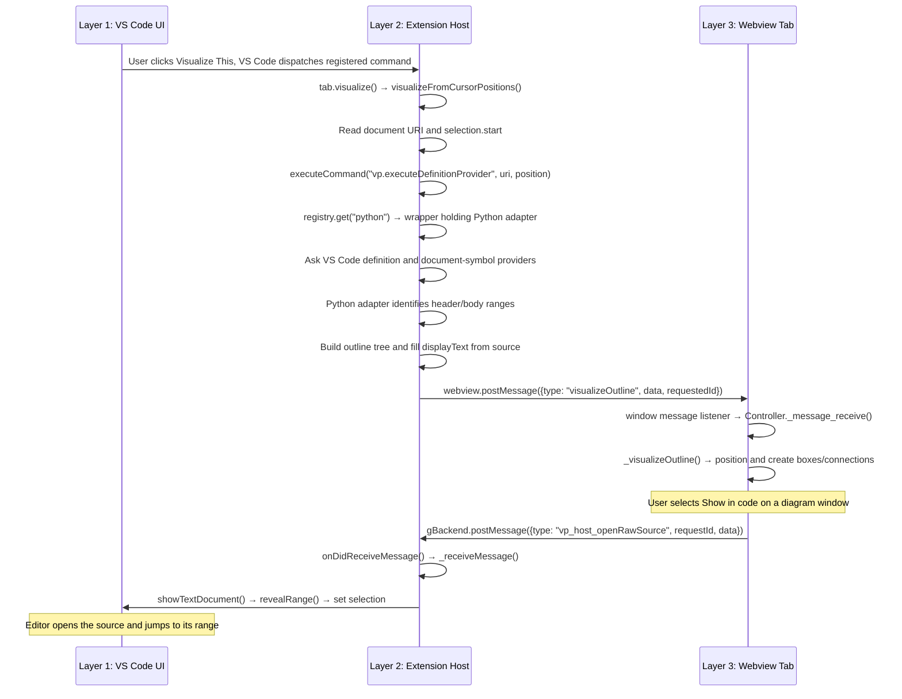

# Architecture and Development Guide

This guide connects runtime behavior, build scripts, and source files. Paths are relative to the repository root.

## I. How the Three-Layer Architecture Works

The three layers are responsibility boundaries, not three npm packages:

| Layer | Responsibility | Runtime |
| --- | --- | --- |
| **1. VS Code UI** | Editor, cursor, context menus, command palette, navigation | VS Code workbench |
| **2. Extension Host** | Handle commands, obtain code information, adapt it for diagrams, manage webviews | Extension-host JavaScript runtime |
| **3. Webview Tab** | Display boxes and edges; handle diagram interaction | Embedded browser |

### Summary of the Flow



The UI-to-host arrow represents VS Code's command dispatch, not a custom `postMessage` protocol. The two explicit `postMessage` calls cross the host/webview boundary. They are asynchronous messages, not direct calls into the receiving function.

### How Python Registration Connects to a Click

1. `extension_main.ts::activate()` initializes the internal API, registers language adapters, and registers user commands.
2. `outlineproviders/providerregistrer.ts` creates `new VpLspExtenderPython()` and calls `vp.registerLspExtenderProvider`.
3. The API handler wraps that object in `VpOutlineProviderWrapper` and stores it under `python`. Registry keys are lowercased.
4. Later, **Visualize This** captures the active file URI and caret position.
5. `vp.executeDefinitionProvider` opens the document, reads `document.languageId`, retrieves the stored wrapper, and calls `provideDefinitionOutline()`.
6. The wrapper passes the same Python adapter to `OutlineUtils.provideDefinitionOutline()`.

Registration stores an object for later use; it does not analyze the file yet.

### Definition Lookup → Python Adaptation → Diagram

Inside `OutlineUtils`, the connected path is:

```text
provideDefinitionOutline(adapter, document, position, chooseTarget?, resolveTargetAdapter?)
  → _getDefinitionRanges(...)
    → normalize and deduplicate VS Code Location / LocationLink targets
    → open one target directly, or await the host Quick Pick chooser
    → file root: provideDocumentOutline(...)
    → declaration: exact provider symbol or adapter-proven syntax target
  → documentSymbol2outlineSymbol(...)
    → adapter.getLanguageSpecificSymbolInformation(document, docSymbol, {ancestors})
    → recursively build parts from child declarations and ordinary text
```

- **`vp.executeDefinitionProvider`** is this repository's command: build diagram-ready information.
- **`vscode.executeDefinitionProvider`** is VS Code's command: find the identifier's definition. Different IDs mean no recursive command loop.
- A definition target retains URI, full range, selection range, and optional origin range. `DefinitionOutlineResult` is `Array<Symbol | File> | null`: `null` means cancelled, `[]` means unresolved, and a rejection is a concrete lookup/open/extraction failure. Multiple distinct targets require a chooser; non-UI callers without one reject rather than choosing silently.
- Multiple-definition UI lives in `visualprogramming/definition_picker.ts`. Rows show the declaration's source line rather than only the selected identifier, workspace-relative or common-parent-relative file locations, declaration-only metadata, source origin, and available document-symbol member summaries. Each file's document/symbol request is reused within one picker. Missing optional symbol context does not invent a signature; unavailable files remain explicitly labeled choices. Provider order and target identity are preserved.
- The picker appears while metadata loads. Its title-bar file button previews the highlighted target's exact source selection in an editor without accepting or closing the picker. Enter accepts the selected target; Escape cancels, including while loading. Disposal detaches handlers and ignores late metadata results. Preview does not execute source or change parser/language support.
- `VpLspExtenderPython` is **not a language server**. It supplements symbols obtained through installed Python tooling, typically Python/Pylance, with Python-specific header/body ranges.
- For `class Dog:` containing `def bark(self):`, the current adapter extracts headers `Dog` and `bark(self)`. Shared code creates nested `Symbol` and `Text` parts.
- `translateOutlineRanges()` in `visualprogramming/outline_entities.ts` fills `displayText` from validated source ranges before `VisualizingTab` sends the tree to the webview.

### Declaration Boundaries

- `Outline.Symbol.totalRange` normally equals the supplied `DocumentSymbol.range`. Syntax-backed exceptions are Python name-only assignments and JS/TS name-only declarations or owned callable RHS selections. The adapter returns optional `rangeDeclaration`; provider objects remain unchanged.
- Python loads `@lezer/python` on first extraction and retains one declaration/ancestor fragment per document. Its fragment parser is unchanged by the JS/TS upgrade.
- JavaScript/TypeScript/experimental TSX lazily load the exact `typescript-parser` alias, TypeScript 6.0.3. Each adapter retains one on-demand actual-document syntax snapshot in a `WeakMap`, keyed by document identity, version, registered language and filename. JS/TS/TSX mode is explicit; actual filenames retain module/declaration context.
- Each new JS/TS snapshot creates one in-memory `noResolve`/`noLib`/`noEmit` compiler program for public syntactic diagnostics. Only the SourceFile, diagnostics, declaration-start index and optional comment ranges survive. No imports, project analysis, execution, background index or source writes occur.
- JS/TS matching proves declaration/binding identity, full executable-body containment and diagnostic isolation. Only exact name-only declarations or owned callable initializer/RHS selections can expand. Transparent expression wrappers identify callable owners without changing displayed source. Anonymous callbacks remain separate declarations; provider display names do not suppress JS/TS callback rows.
- The named result contains `rangeHead`, nullable `rangeBody`, `attributes`, `declarationOnly`, optional `rangeDeclaration`, optional display-child projection, and optional `definitionPosition`. A null body means no source body; a zero-width body means an empty implementation.
- TypeScript bodyless signatures set `declarationOnly`; the webview hides their body area while retaining the signature and navigation. No status text or badge is added. Python `pass`, `...`, and docstrings remain source.
- Shared traversal sorts a copy of children, keeps source gaps, and rejects crossing/overlapping displayed children. Definition lookup uses end-exclusive containment and target-file ranges.
- Cached Python ancestors may include trailing comment tokens beyond a child method's Pylance range. Boundary matching ignores only that comment-only syntax suffix when checking completeness; rendered ranges remain provider-bounded and errors or truncated executable tokens still fail. Excluded inline comments remain in the enclosing class's source gaps.
- Pylance 2026.4.1 supplies name-only ranges for Python variables/constants. For an exact name-only variable/constant/field/property range, reuse suitable cached/ancestor syntax or parse from the name's physical line. Extend the local fragment geometrically only while the selected statement has missing tokens at its end; use the parsed statement boundary, never the next colon or next symbol. Malformed syntax and reference selections still fail explicitly. Other incomplete ranges are not repaired.
- Multiline decorator attributes retain their full original source in the model/hover text. The window displays only a compact first-line metadata label, constrained to one line with ellipsis, so it cannot overlap the signature/body.
- Python-related changes require live verification of `../../MAFC/Workspace/airflow-data/dags/ingestion/table_level/trino_ingestion_dag_factory.py`: file → `_build_dag` → `ingestion_dag`, plus affected variables. Do not execute or modify that Airflow file.
- JS/TS callable variable/property/field/constant initializers become declaration rows. Only an immediate wrapper with exactly the same AST callable/transparent-expression range is projected; all other provider children survive. Raw and effective child ranges retain strict overlap/crossing checks.
- Assignment headings include their receiver. Their syntax-backed `definitionPosition` keeps row lookup on the callable, not on the receiver local. Definition requests normalize serialized webview positions into VS Code `Position` instances before comparisons. **Show in code** still selects the displayed heading's source start.
- Empty `(0,0)` definition targets open files before declaration lookup. Full-document targets open files only when no declaration has exactly that range. File identity is URI-based, its display range is `(0,0)`, and its parts retain whitespace gaps and EOF. **Show in code** opens its beginning without inventing a symbol `totalRange`.
- Python decorator attributes retain a `definitionRange` for the terminal callable identifier, including qualified and multiline decorators. Descriptive attributes such as `async` have no navigation range. The Python `getDefinitionSymbol` hook proves omitted assignment targets or direct parameter declarations from syntax; it never substitutes an enclosing method for an unmapped reference.
- Production wrappers resolve target adapters through the existing language registry at navigation time. Same-language requests use the supplied adapter; cross-language routing is limited to JavaScript, TypeScript and experimental TSX, and requires an installed target adapter. Python cross-language navigation remains rejected. Target URI/selection, chooser cancellation, deduplication and source-reference formats are unchanged. Actual `.pyi` source remains labeled **Type stub — declaration only**; no implementation filename is guessed.
- YAML container endpoints use CST `valueRange` (with original CRLF offsets), not trailing parser trivia in `range`. Sequence and mapping descriptors use the same value boundary so indentation of a following dedented sibling cannot extend a child past its parent. Source gaps and document separators remain in the enclosing outline; strict containment and overlap validation stay enabled.

### Canvas Window Geometry

- Zoom is Ctrl-only or Alt-only wheel, bounded to 0.2–3. Translation uses the old/new DOM rects and scales to preserve the source point under the cursor. Input at a bound leaves translation untouched.
- `VgfWindowTitled.vp_fitToContent()` runs for every newly created node after themed world attachment, or on grip double-click. Intrinsic DOM measurement fits content up to 1200 world px wide, then measures height after heading reflow, with at most 400px initial body height. Code bodies scroll rather than wrap. Short nodes remain content-sized; manual resize can exceed 1200px. Later focus/zoom and existing-node reuse do not refit.
- The outer frame owns a pointer-captured 14px grip and keeps visible overflow for dockers. Flex inner containers shrink into one `.VgfExpandableContent` scroll viewport. Declaration headings and declaration rows collapse display whitespace and wrap to the current node width; widening can join a multiline source signature onto one rendered line. Close/collapse controls stay fixed. Code bodies retain original formatting and horizontal/vertical scrolling. Clicking a source body locks ordinary/Shift-wheel to that viewport, marked by a gold outline, including at scroll limits and when the pointer leaves it. Clicking outside releases the lock; clicking another body transfers it. Ctrl/Alt-wheel retains canvas zoom. Unlocked hover scrolling retains its boundary-to-canvas behavior.
- Resize uses screen delta divided by positive world scale, with 120px minimum width and title/chrome minimum height. Collapse saves/restores expanded height without changing width. Existing outer ResizeObserver events update edges; descendant scroll emits `vp_windowMoved`.
- `SourceNavigation` binds immutable source text/ranges to headings, compact decorator badges, and read-only code rows. Source bodies remain selectable but never enable editing when comments are shown. Whitespace-only source blocks stay in the source model/DOM for mapping but occupy no layout space, regardless of comment visibility. Double-click or F12 captures UTF-16 source offsets; heading reflow, CRLF normalization, tabs, Unicode, highlight spans, CSS gutters, and synthetic ellipses do not become source columns. Declaration rows/buttons retain their single-click action; non-code header chrome remains draggable.
- Connections retain the captured URI/range and source offsets, not the current selection or a highlight-node identity. Their source point is the final code point's trailing edge and midpoint, clipped against the frame and every ancestor scrollport. Hidden source falls back to the owning heading, then frame; clipped compact metadata uses its own badge. Docker hover identifies the original location and fallback reason.
- Source bindings cache text indexes and DOM ranges, invalidate on real text/child changes, and reuse owner movement/scroll/lifecycle events. Identical re-highlighting reconstructs ranges. Local edits that diverge from the immutable source produce **Source mapping unavailable** without sending stale coordinates; reopening restores mapping. Bindings and edges are cleaned through the owning window's deletion event.
- Focusing a source window keeps its outgoing connections behind its reading surface. Leaving it emits `vp_windowUnfocused`; each connection raises its current dock-owning target (or the undocked connector) above the previous source, then the newly selected window is raised last. Primary-clicking empty canvas clears visual focus and restores those edges too. This changes stacking only, not node positions, source ranges, or edge identity.
- Without a clicked body lock, a canvas-started wheel gesture stays on the canvas when crossing a box. After 180ms idle, the next gesture can begin as content scrolling. Clicking a source body explicitly takes wheel ownership even during touchpad momentum. Pan uses subpixel CSS positions rather than rounded `offsetTop`/`offsetLeft`, preserving small touchpad and momentum deltas.
- Empty-canvas left/right/middle drag pans; Shift+left drag starts rectangle selection, with Space+left retaining its pan override. Plain left click without a drag clears group selection; panning preserves it. Background context menus are suppressed so right-drag stays on the canvas; node, popup, and toolbar interactions are excluded.
- `WindowPositioner.placeWindow()` measures new attached frames, keeps 24 world px clearance, and advances only the new candidate downward. LEFT slots subtract the new width. Missing/deleted anchors use a viewport-relative slot and cannot receive connections.
- After a batch, `revealWindow()` eases the minimum camera translation over 450ms with smooth acceleration/deceleration, showing the last new frame with a 20px viewport inset; oversized frames align their beginning. The clock starts on the first rendered frame so response layout cannot consume the transition before it is visible. A new response supersedes the old reveal. Native wheel, pointer/keyboard input, drag, deletion, or external camera changes cancel it without swallowing input or snapping later. Active user gestures take priority over auto-reveal.
- Nodes-list activation uses `CanvasCamera.fitNode()` rather than minimum-distance reveal: center the selected outer frame within toolbar/minimap insets, fit between 0.2 and 1 scale, and cancel any pending reveal. If minimum zoom prevents full fitting, show the frame's beginning with a limit message. Node position/size, collapsed state, body scroll, graph identity, and group selection remain unchanged.
- New windows fade in while their inner presentation translates 20px over 300ms. The outer measured frame stays at its final geometry; per-frame movement notifications keep source connections attached. Interaction ends the entrance immediately. Reduced-motion preferences disable both animations. Reused windows keep their size/position and do not reanimate.
- Each navigation request carries a webview-only `sourceAnchor` in its local ticket; only `{uri, cursorStart, cursorEnd}` crosses to the host. The host validates positions and resolves `cursorStart`. Repeating the same range to the same target reuses its edge; different ranges on one surface keep distinct edges even when their target node is shared.
- `VpwCodeEditor` reserves a shared line-number gutter from the rendered row count (minimum two digits). Right-aligned CSS counters sit outside code flow, with a 12px gap before the source column. They are non-selectable and ignore pointer events; no number text is added to source rows or selection offsets.


### Messages Back from the Diagram

`gBackend` is initialized by `acquireVsCodeApi()` in `media/scriptsVscDependant.js`.

| Webview request type | Host action |
| --- | --- |
| `outline_requestByFilePosition` | Resolve the clicked identifier; send another outline; the diagram can add a window and connection |
| `outline_requestLocationDefiner` | Resolve the enclosing class/file, not necessarily an inheritance parent |
| `vp_host_openRawSource` | Open source, reveal its range, and move the editor selection |

Requests use `requestId`; outline replies use `requestedId`. The controller remembers which diagram element requested an outline so it can position/connect the response.
- `visualizeOutline`, array-shaped `messageBox`, and `outline_cancelled` each settle a navigation ticket. Cancellation creates/focuses nothing. Errors retain provider/open/extraction details; unresolved locations use **Definition not found**. Late replies cannot attach to a deleted source or recreate a disposed/replaced requesting panel.
- **Show in code** is fire-and-forget: it sends no pending diagram ticket because the host opens an editor without an outline reply.

### Debugging and Visible Updates

- The controller constructor registers the `message` listener **once**. Its callback and `_message_receive()` run **for every incoming message**.
- Extension TypeScript: use the **Run Extension** debugger and source breakpoints.
- Canvas JavaScript: use **Webview Developer Tools** and breakpoints in the loaded `web_visualizer.js`. This custom bundle does not generate source maps.
- A message send is not a normal function call: Step Into does not cross into the other runtime. Set a breakpoint on each receiving side.
- Boxes are added to the DOM during `_visualizeOutline()`. Connection docking starts a timer-based animation; movement events later update line endpoints. Creating a connection and visibly drawing its line are separate steps.

## II. Development Boundaries

Requirements: Node.js 24 LTS (or Node.js 22.13+), npm 10+, Python 3, and `tar`. These are development-tool requirements, not a promise of compatibility with every VS Code engine version.

### Commands

Run from the repository root:

| Command | Effect |
| --- | --- |
| `npm run build:web` | Regenerate the canvas JS/CSS bundle |
| `npm run build:ext` | Rebuild the canvas, copy assets to `media/`, and compile extension TypeScript into `out/` |
| `npm run serve:web` | Serve existing browser fixtures; does not build or use live language providers |
| `npm run test:ext` | Compile, lint, and launch extension-host integration tests |
| `npm --prefix src/vscodeextension run package` | Build the VSIX, notices, and corresponding source archive; does not install or publish |

The custom canvas bundler follows `require ("file.js");` declarations reachable from `src/web_visualizer/src/main.js`. These are build directives, not browser imports. `jsstitcher` discovers/orders dependencies and concatenates them; CSS is concatenated separately. Extension TypeScript compiles to CommonJS with source maps and is not part of that canvas bundle.

The canvas `build_system` script uses semicolon-separated commands, so a later success can mask an earlier failure. Inspect failures rather than relying only on the final exit status.

### Running Local Code

- F5 uses `.vscode/launch.json` and `build:ext` to run repository code in an Extension Development Host. Saving alone does not hot-reload it: save, stop debugging, then F5.
- The installed fork ID is `itnccuong.source-code-visualizer`; public commands use `source-code-visualizer.*` and the menu label is **Visualize This**.
- A local VSIX with that same ID replaces the installed Marketplace copy. Building/packaging alone changes neither installation nor a running host. F5 overrides the installed same-ID extension only in its development window.
- To install a packaged build: `code --install-extension src/vscodeextension/release/source-code-visualizer.vsix --force`, then **Developer: Reload Window**. Do not enable inherited legacy builds alongside the fork: their shared internal `vp.*` registrations can collide.
- Keep `features/` focused on feature contracts, implementation logic, meaningful behavioral verification, and limitations. Routine build/install outcomes do not need separate feature records.

### Test and Dependency Boundaries

- `src/vscodeextension/src/test/main.ts` uses `@vscode/test-electron` with current stable VS Code, or `VSCODE_EXECUTABLE_PATH`. It installs Python/Pylance into `.vscode-test/extensions`, propagates installation failures, and uses a short temporary user-data directory. This does not certify the minimum advertised VS Code version.
- A development extension path supersedes an installed same-ID package. To verify an installed package, use a separate driver, an explicit installed-extensions directory, and check Production mode; do not confuse that with source-host verification.
- Runtime syntax parsing uses the pinned `typescript-parser` npm alias. The separate development `typescript` compiler, ESLint, Mocha, VSCE, and test-electron are not runtime dependencies.
- ESLint's flat configuration preserves the parser-only lint policy; TypeScript performs type checking. Test discovery uses glob's promise API and Mocha's CommonJS entry point.
- Patched glob/minimatch overrides prevent vulnerable transitive constraints from reintroducing older versions. Review consumers before removing them. Dependency changes require clean installation, full/development and production advisory review, integration verification, and package inspection.
- Vendored highlight.js is outside npm audit. A clean advisory scan is not an application-security certification.

### Distribution Boundaries

- `scripts/prepare-release.js` follows the production dependency closure, resolves npm aliases, preserves package-local notices, and generates aggregate license files from original inputs. Do not edit generated licenses.
- Every VSIX contains `source/source-code-visualizer-<version>.tar.gz`: corresponding first-party source, lockfile, build scripts, and original notices, excluding installed dependencies and generated output. See [source and redistribution requirements](../src/vscodeextension/SOURCE.md) for LGPLv3/GPLv3, third-party licensing, and inherited attribution decisions.
- README images use relative local links and explicit HTTPS bases when packaged. Original GIFs remain outside the VSIX; preserve their original quality rather than silently re-encoding them. Public README assets must exist at the configured fork URLs.
- Original icon artwork is `src/vscodeextension/icon.svg`; `icon.png` is the rendered Marketplace asset. The SVG remains in the corresponding source archive.
- Packaging, installation, and Marketplace publication are distinct operations. Publication requires publisher access and matching public source; local build success is not publication evidence.

## III. Component and Generated-File Map

### Layer 1 — VS Code UI and Development Controls

| File | Purpose |
| --- | --- |
| `src/vscodeextension/package.json` | Declare menu entries, user command IDs, extension entry point, dependencies, and extension scripts |
| `.vscode/launch.json` | Launch the local extension from `src/vscodeextension`; map compiled JS back to TypeScript |
| `.vscode/tasks.json` | Define the pre-launch `build:ext` task |
| `package.json` | Root convenience commands; not the extension manifest |

The editor and menu implementation belong to VS Code itself; this repository contributes declarations and handlers.

### Layer 2 — Extension Host Source

Paths in this table are under `src/vscodeextension/src/`.

| File/component | Purpose |
| --- | --- |
| `extension_main.ts` | Activation entry point; initialize API, language adapters, and user commands |
| `visualprogramming/extensionactivator.ts` | Register Visualize commands; `VpTabManager` obtains the diagram tab |
| `visualprogramming/visualizer.ts` | `VisualizingTab`: capture selections, request outlines, fill source text, send messages, handle browser requests, navigate editor |
| `visualprogramming/definition_picker.ts` | Describe definition candidates, preview source, preserve exact selection, and handle cancellation |
| `visualprogramming/webviewcreator.ts` | Create the Code Diagram webview and its HTML; load assets from `media/` |
| `outlineproviders/providerregistrer.ts` | Register default language adapters, including Python |
| `outlineproviders/lspextenderpython.ts` | `VpLspExtenderPython`: derive Python header/body ranges from a document symbol |
| `outlineproviders/lspextendertypescript.ts` | `VpLspExtenderTypeScript`: document syntax cache, indexed JS/TS/TSX declaration extraction, syntax-backed targets and comments |
| `outlineproviderAPI/extensionactivator.ts` | Register internal `vp.*` commands and dispatch to the language registry |
| `outlineproviderAPI/utils/languagefeatureregistry.ts` | Store/get providers using lowercased language IDs |
| `outlineproviderAPI/utils/outlineproviderwrapper.ts` | Hold a language adapter and delegate to shared outline utilities |
| `outlineproviderAPI/utils/outlineutils.ts` | Query VS Code definitions/symbols and construct recursive outline data |
| `outlineproviderAPI/utils/documentsymbolx.ts` | Pair a document symbol with its file URI |
| `outlineproviderAPI/SymbolDefinition.ts` | Shared outline model: `Symbol`, `Text`, `File`, ranges, attributes, nested parts |

### Layer 3 — Webview Source and Bridge

Paths are under `src/web_visualizer/src/` unless stated otherwise.

| File/component | Purpose |
| --- | --- |
| `main.js` | Bundler entry point; `initSystem()` creates the diagram root and controller |
| `vp/controller.js` | Receive messages, request definitions, track requesters, create/position windows and connections |
| `vp/request_message.js` | `RequestMessage`: read message type, data, and reply ID; a local class, not an npm package |
| `vp/view_entity.js` | Hold a visualized model and window state such as coordinates |
| `vp/window_positioner.js` | Initial/relative window placement using offsets |
| `vpw/vpw_world.js` | Create outline windows and connections within the world |
| `vpw/vpw_outline_window.js` | Render outline titles and nested content; provide Show in code/Open parent actions |
| `vpw/vpw_view_entity_window.js` | Attach the view model to a titled window and set its position |
| `vpw/vpw_entity_connection.js` | Connect source/target widgets; update line endpoints on movement |
| `vgf/vgf_world.js` | World root, scale, and coordinate conversion |
| `vgf/vgf_navigationarea.js` | Background pan, wheel scrolling, and zoom |
| `vgf/` | Reusable GUI primitives: windows, docking, widgets, menus, and canvas lines |
| `utils/std.js` | Shared helpers, including timer-driven `moveAnimated()` |
| `highlightjs/` | Vendored syntax-highlighting code/styles |
| `src/vscodeextension/media/scriptsVscDependant.js` | Handwritten webview bridge: `const gBackend = acquireVsCodeApi()` |

### Source Versus Generated Outputs

| Location | What it contains | Editing rule |
| --- | --- | --- |
| `src/vscodeextension/src/` | Original extension TypeScript | Edit here for host behavior |
| `src/vscodeextension/out/` | Generated extension `.js` and `.js.map` files | Do not edit; regenerated by `tsc`; executed by extension host |
| `src/web_visualizer/src/` | Original canvas JavaScript/CSS | Edit here for canvas behavior/layout |
| `src/web_visualizer/release/` | Generated JS/CSS bundle, license, version | Do not edit; rebuilt and copied into extension |
| `src/vscodeextension/media/web_visualizer.js` and `.css` | Generated/copied visualizer assets | Do not edit as a permanent fix; these are what the webview loads |
| Other files in `src/vscodeextension/media/` | Can be handwritten, notably `scriptsVscDependant.js` | Do not assume the entire directory is generated |
| `src/web_visualizer/tests/` | Standalone browser fixtures and backend emulation | Useful for canvas-only work; not production parsing |
| `src/vscodeextension/src/test/` | Extension integration tests and sample code | Test source, not generated output |
| `node_modules/` | Installed third-party packages | Do not edit for project fixes |
| `src/vscodeextension/release/` | Packaging outputs such as `.vsix`, license, version | Release artifacts, not runtime source |

**For humans and AI:** change original source, rebuild, and debug the runtime that owns the behavior. `out/` is extension-host output; the generated visualizer files in `media/` are browser output. A generated copy is not a second implementation to maintain.
