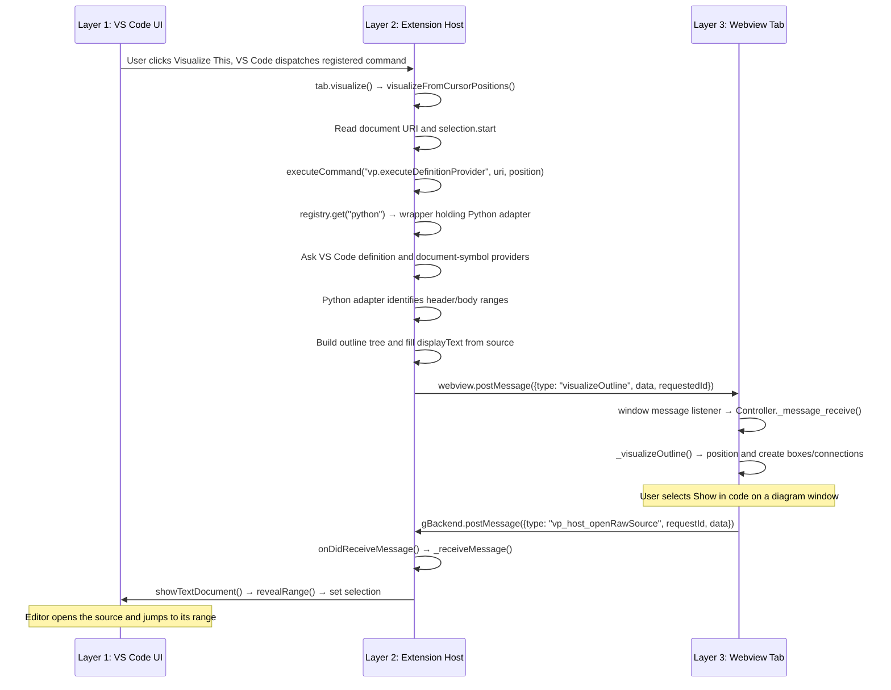
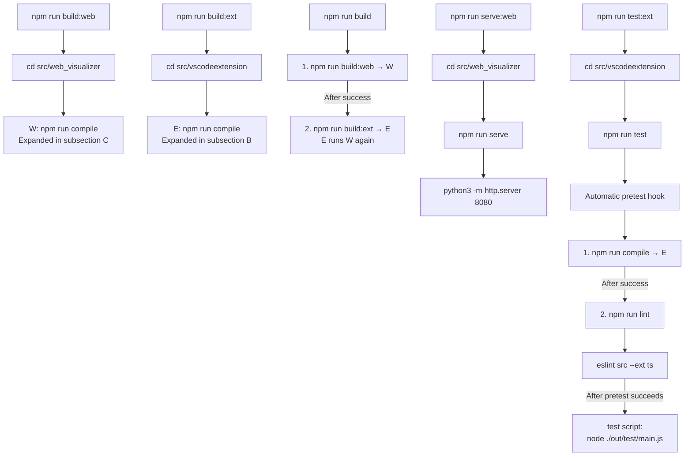
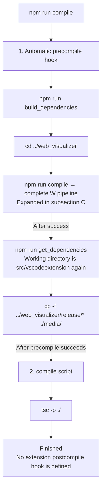
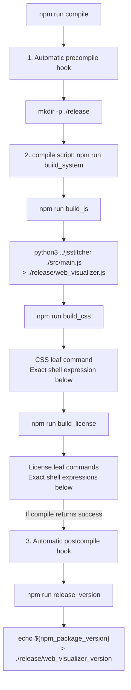
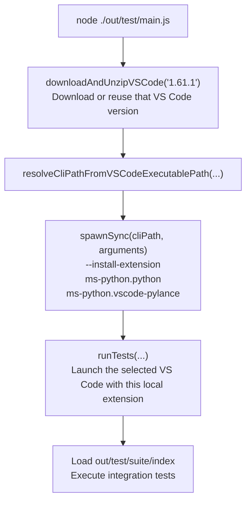

# Architecture and Development Guide

This guide connects runtime behavior, build scripts, and source files. Paths are relative to the repository root.

## I. How the Three-Layer Architecture Works

The three layers are responsibility boundaries, not three npm packages:

| Layer | Responsibility | Runtime |
| --- | --- | --- |
| **1. VS Code UI** | Editor, cursor, context menus, command palette, navigation | VS Code workbench |
| **2. Extension Host** | Handle commands, obtain code information, adapt it for diagrams, manage webviews | Extension-host JavaScript runtime |
| **3. Webview Tab** | Display boxes and edges; handle diagram interaction | Embedded browser |

### Summary of the Flow



The UI-to-host arrow represents VS Code's command dispatch, not a custom `postMessage` protocol. The two explicit `postMessage` calls cross the host/webview boundary. They are asynchronous messages, not direct calls into the receiving function.

### How Python Registration Connects to a Click

1. `extension_main.ts::activate()` initializes the internal API, registers language adapters, and registers user commands.
2. `outlineproviders/providerregistrer.ts` creates `new VpLspExtenderPython()` and calls `vp.registerLspExtenderProvider`.
3. The API handler wraps that object in `VpOutlineProviderWrapper` and stores it under `python`. Registry keys are lowercased.
4. Later, **Visualize This** captures the active file URI and caret position.
5. `vp.executeDefinitionProvider` opens the document, reads `document.languageId`, retrieves the stored wrapper, and calls `provideDefinitionOutline()`.
6. The wrapper passes the same Python adapter to `OutlineUtils.provideDefinitionOutline()`.

Registration stores an object for later use; it does not analyze the file yet.

### Definition Lookup → Python Adaptation → Diagram

Inside `OutlineUtils`, the connected path is:

```text
provideDefinitionOutline(adapter, document, position, chooseTarget?)
  → _getDefinitionRanges(...)
    → normalize and deduplicate VS Code Location / LocationLink targets
    → open one target directly, or await the host Quick Pick chooser
    → file root: provideDocumentOutline(...)
    → declaration: exact/smallest document symbol, or Python syntax-backed target
  → documentSymbol2outlineSymbol(...)
    → adapter.getLanguageSpecificSymbolInformation(document, docSymbol, {ancestors})
    → recursively build parts from child declarations and ordinary text
```

- **`vp.executeDefinitionProvider`** is this repository's command: build diagram-ready information.
- **`vscode.executeDefinitionProvider`** is VS Code's command: find the identifier's definition. Different IDs mean no recursive command loop.
- A definition target retains URI, full range, selection range, and optional origin range. `DefinitionOutlineResult` is `Array<Symbol | File> | null`: `null` means cancelled, `[]` means unresolved, and a rejection is a concrete lookup/open/extraction failure. Multiple distinct targets require a chooser; non-UI callers without one reject rather than choosing silently.
- `VpLspExtenderPython` is **not a language server**. It supplements symbols obtained through installed Python tooling, typically Python/Pylance, with Python-specific header/body ranges.
- For `class Dog:` containing `def bark(self):`, the current adapter extracts headers `Dog` and `bark(self)`. Shared code creates nested `Symbol` and `Text` parts.
- `VisualizingTab._translate_outlineRanges2outlineEntities()` fills `displayText` using `document.getText(range)` before sending the tree to the webview.

### Declaration Boundaries

- `Outline.Symbol.totalRange` normally equals the supplied `DocumentSymbol.range`. Syntax-backed exceptions are Python name-only assignments and JavaScript RHS-only callable assignments. The adapter returns optional `rangeDeclaration`; provider objects remain unchanged.
- Python loads `@lezer/python` on first extraction. JavaScript/TypeScript/TSX reuse TypeScript 3.9.10 in JS/TS/TSX mode. Parsing remains declaration-local or uses supplied ancestor context, not a background whole-file index.
- Each adapter retains one parsed fragment per document in a `WeakMap`. Version, language, and containment govern reuse. Temporary parser wrappers never enter output ranges.
- An ambiguous TypeScript property or incomplete JavaScript assignment can use supplied ancestor syntax. Missing context, ambiguous matches, and malformed selected syntax produce extraction errors.
- The named result contains `rangeHead`, nullable `rangeBody`, `attributes`, `declarationOnly`, optional `rangeDeclaration`, optional display-child projection, and optional `definitionPosition`. A null body means no source body; a zero-width body means an empty implementation.
- TypeScript bodyless signatures set `declarationOnly`; the webview hides their body area while retaining the signature and navigation. No status text or badge is added. Python `pass`, `...`, and docstrings remain source.
- Shared traversal sorts a copy of children, keeps source gaps, and rejects crossing/overlapping displayed children. Definition lookup uses end-exclusive containment and target-file ranges.
- Pylance 2026.4.1 supplies name-only ranges for Python variables/constants. For an exact name-only variable/constant/field/property range, reuse suitable cached/ancestor syntax or parse from the name's physical line. Extend the local fragment geometrically only while the selected statement has missing tokens at its end; use the parsed statement boundary, never the next colon or next symbol. Malformed syntax and reference selections still fail explicitly. Other incomplete ranges are not repaired.
- Multiline decorator attributes retain their full original source in the model/hover text. The window displays only a compact first-line metadata label, constrained to one line with ellipsis, so it cannot overlap the signature/body.
- Python-related changes require live verification of `../../MAFC/Workspace/airflow-data/dags/ingestion/table_level/trino_ingestion_dag_factory.py`: file → `_build_dag` → `ingestion_dag`, plus affected variables. Do not execute or modify that Airflow file.
- JavaScript callable variable/property/field/constant initializers become declaration rows. Only an immediate wrapper with exactly the same AST function/parenthesis range is transparent; its children are projected without changing the provider tree. Raw and effective child ranges retain strict overlap/crossing checks.
- Assignment headings include their receiver. Their syntax-backed `definitionPosition` keeps row lookup on the callable, not on the receiver local. Definition requests normalize serialized webview positions into VS Code `Position` instances before comparisons. **Show in code** still selects the displayed heading's source start.
- Empty `(0,0)` definition targets open files before declaration lookup. Full-document targets open files only when no declaration has exactly that range. File identity is URI-based, its display range is `(0,0)`, and its parts retain whitespace gaps and EOF. **Show in code** opens its beginning without inventing a symbol `totalRange`.
- Python decorator attributes retain a `definitionRange` for the terminal callable identifier, including qualified and multiline decorators. Descriptive attributes such as `async` have no navigation range. The Python `getDefinitionSymbol` hook proves omitted assignment targets or direct parameter declarations from syntax; it never substitutes an enclosing method for an unmapped reference.
- The selected target must have the origin document's language ID. Actual `.pyi` source is retained and labeled **Type stub — declaration only**; no implementation filename is guessed and no analyzed code is executed. Unsupported syntax remains an explicit extraction failure. For example, live `builtins.pyi` `bool` opened, while `str` failed on `capitalize`; this is not general stub-extraction parity.

### Canvas Window Geometry

- Zoom is Ctrl-only or Alt-only wheel, bounded to 0.2–3. Translation uses the old/new DOM rects and scales to preserve the source point under the cursor. Input at a bound leaves translation untouched.
- `VgfWindowTitled.vp_fitToContent()` runs for every newly created node after themed world attachment, or on grip double-click. Intrinsic DOM measurement fits content up to 1200 world px wide, then measures height after heading reflow, with at most 400px initial body height. Code bodies scroll rather than wrap. Short nodes remain content-sized; manual resize can exceed 1200px. Later focus/zoom and existing-node reuse do not refit.
- The outer frame owns a pointer-captured 14px grip and keeps visible overflow for dockers. Flex inner containers shrink into one `.VgfExpandableContent` scroll viewport. Declaration headings and declaration rows collapse display whitespace and wrap to the current node width; widening can join a multiline source signature onto one rendered line. Close/collapse controls stay fixed. Code bodies retain original formatting and horizontal/vertical scrolling. Clicking a source body locks ordinary/Shift-wheel to that viewport, marked by a gold outline, including at scroll limits and when the pointer leaves it. Clicking outside releases the lock; clicking another body transfers it. Ctrl/Alt-wheel retains canvas zoom. Unlocked hover scrolling retains its boundary-to-canvas behavior.
- Resize uses screen delta divided by positive world scale, with 120px minimum width and title/chrome minimum height. Collapse saves/restores expanded height without changing width. Existing outer ResizeObserver events update edges; descendant scroll emits `vp_windowMoved`.
- `SourceNavigation` binds immutable source text/ranges to headings, compact decorator badges, and editable code rows. Double-click or F12 captures UTF-16 source offsets; heading reflow, CRLF normalization, tabs, Unicode, highlight spans, CSS gutters, and synthetic ellipses do not become source columns. Declaration rows/buttons retain their single-click action; non-code header chrome remains draggable.
- Connections retain the captured URI/range and source offsets, not the current selection or a highlight-node identity. Their source point is the final code point's trailing edge and midpoint, clipped against the frame and every ancestor scrollport. Hidden source falls back to the owning heading, then frame; clipped compact metadata uses its own badge. Docker hover identifies the original location and fallback reason.
- Source bindings cache text indexes and DOM ranges, invalidate on real text/child changes, and reuse owner movement/scroll/lifecycle events. Identical re-highlighting reconstructs ranges. Local edits that diverge from the immutable source produce **Source mapping unavailable** without sending stale coordinates; reopening restores mapping. Bindings and edges are cleaned through the owning window's deletion event.
- Focusing a source window keeps its outgoing connections behind its reading surface. Leaving it emits `vp_windowUnfocused`; each connection raises its current dock-owning target (or the undocked connector) above the previous source, then the newly selected window is raised last. Primary-clicking empty canvas clears visual focus and restores those edges too. This changes stacking only, not node positions, source ranges, or edge identity.
- Without a clicked body lock, a canvas-started wheel gesture stays on the canvas when crossing a box. After 180ms idle, the next gesture can begin as content scrolling. Clicking a source body explicitly takes wheel ownership even during touchpad momentum. Pan uses subpixel CSS positions rather than rounded `offsetTop`/`offsetLeft`, preserving small touchpad and momentum deltas.
- `WindowPositioner.placeWindow()` measures new attached frames, keeps 24 world px clearance, and advances only the new candidate downward. LEFT slots subtract the new width. Missing/deleted anchors use a viewport-relative slot and cannot receive connections.
- After a batch, `revealWindow()` eases the minimum camera translation over 450ms with smooth acceleration/deceleration, showing the last new frame with a 20px viewport inset; oversized frames align their beginning. The clock starts on the first rendered frame so response layout cannot consume the transition before it is visible. A new response supersedes the old reveal. Native wheel, pointer/keyboard input, drag, deletion, or external camera changes cancel it without swallowing input or snapping later. Active user gestures take priority over auto-reveal.
- New windows fade in while their inner presentation translates 20px over 300ms. The outer measured frame stays at its final geometry; per-frame movement notifications keep source connections attached. Interaction ends the entrance immediately. Reduced-motion preferences disable both animations. Reused windows keep their size/position and do not reanimate.
- Each navigation request carries a webview-only `sourceAnchor` in its local ticket; only `{uri, cursorStart, cursorEnd}` crosses to the host. The host validates positions and resolves `cursorStart`. Repeating the same range to the same target reuses its edge; different ranges on one surface keep distinct edges even when their target node is shared.
- `VpwCodeEditor` reserves a shared line-number gutter from the rendered row count (minimum two digits). Right-aligned CSS counters sit outside code flow, with a 12px gap before the source column. They are non-selectable and ignore pointer events; no number text is added to source rows or selection offsets.


### Messages Back from the Diagram

`gBackend` is initialized by `acquireVsCodeApi()` in `media/scriptsVscDependant.js`.

| Webview request type | Host action |
| --- | --- |
| `outline_requestByFilePosition` | Resolve the clicked identifier; send another outline; the diagram can add a window and connection |
| `outline_requestLocationDefiner` | Resolve the enclosing class/file, not necessarily an inheritance parent |
| `vp_host_openRawSource` | Open source, reveal its range, and move the editor selection |

Requests use `requestId`; outline replies use `requestedId`. The controller remembers which diagram element requested an outline so it can position/connect the response.
- `visualizeOutline`, array-shaped `messageBox`, and `outline_cancelled` each settle a navigation ticket. Cancellation creates/focuses nothing. Errors retain provider/open/extraction details; unresolved locations use **Definition not found**. Late replies cannot attach to a deleted source or recreate a disposed/replaced requesting panel.
- **Show in code** is fire-and-forget: it sends no pending diagram ticket because the host opens an editor without an outline reply.

### Debugging and Visible Updates

- The controller constructor registers the `message` listener **once**. Its callback and `_message_receive()` run **for every incoming message**.
- Extension TypeScript: use the **Run Extension** debugger and source breakpoints.
- Canvas JavaScript: use **Webview Developer Tools** and breakpoints in the loaded `web_visualizer.js`. This custom bundle does not generate source maps.
- A message send is not a normal function call: Step Into does not cross into the other runtime. Set a breakpoint on each receiving side.
- Boxes are added to the DOM during `_visualizeOutline()`. Connection docking starts a timer-based animation; movement events later update line endpoints. Creating a connection and visibly drawing its line are separate steps.

## II. How the package.json Build Scripts Work

### npm Script Rules

`npm run NAME` executes `scripts.NAME` from the selected package. npm automatically checks for matching hooks:

```text
preNAME → NAME → postNAME
```

For example, `npm run compile` runs `precompile`, then `compile`, then `postcompile`, wherever those scripts exist. Running `tsc` directly does not run npm hooks.

- `A && B`: run B only if A succeeds.
- `A; B`: attempt B even if A fails.
- `>` overwrites an output file; `>>` appends.
- A `cd` inside a child npm script does not permanently change the calling script's directory.

### A. Every Command Available from the Repository Root

The root `package.json` exposes five scripts. **W** below means the complete canvas pipeline in subsection C; **E** means the complete extension pipeline in subsection B. These are diagram labels, not additional npm commands.

Arrows show execution order, not concurrent work. A referenced pipeline finishes before execution continues to the next node.



- Root `build` runs `npm run build:web && npm run build:ext`. It currently builds the canvas **twice**: once explicitly, then again inside E.
- `serve:web` starts a long-running static server. It does **not** build first or rebuild when source changes.
- After building and serving, open `http://localhost:8080/tests/index.html` for browser fixtures. These use emulated backend data, not live Python analysis.
- `test:ext` builds and lints before starting the integration-test program. Its behavior after the Node command is expanded in subsection D.
- Running a root build command alone does not launch or reload VS Code.

### B. E — Complete Extension Compile Pipeline

**Package and working directory: `src/vscodeextension/`.**

The scripts that connect the calls are:

```json
"build_dependencies": "cd ../web_visualizer && npm run compile",
"get_dependencies": "cp -f ../web_visualizer/release/* ./media/",
"precompile": "npm run build_dependencies && npm run get_dependencies",
"compile": "tsc -p ./"
```



The child `build_dependencies` script changes its own shell's directory to build the canvas. That does not change the parent npm process's directory: `get_dependencies` still starts in `src/vscodeextension/`.

The leaf command `tsc -p ./` uses `src/vscodeextension/tsconfig.json`. It translates extension `.ts` files into separate `.js` files under `out/`, with `.js.map` source maps. It does not combine them into the canvas bundle.

For example:

```text
src/vscodeextension/src/outlineproviders/lspextenderpython.ts
    → src/vscodeextension/out/outlineproviders/lspextenderpython.js
    → src/vscodeextension/out/outlineproviders/lspextenderpython.js.map
```

### C. W — Complete Canvas Compile Pipeline

**Package and working directory: `src/web_visualizer/`.**



The exact CSS leaf command is:

```bash
cat `find ./src -type f -name "*.css"` > ./release/web_visualizer.css
```

`find` supplies the CSS filenames; `cat` concatenates their contents into the output file.

The exact license leaf commands are:

```bash
echo 'This file is generated by package.json' > ./release/LICENSE;
cat `find . -type f -name "LICENSE" -not -path "./release/*"` >> ./release/LICENSE
```

The first command writes a header; the second finds license files outside `release/` and appends their contents.

`npm_package_version` is provided by npm from this package's version. The version file therefore describes the canvas package, not the root package.

**Failure-handling detail:** `build_system` is defined as:

```json
"build_system": "npm run build_js; npm run build_css; npm run build_license;"
```

These semicolons mean it attempts the next command even if the preceding one fails. A later successful command can mask an earlier failure, so inspect the build log rather than relying only on the final exit status. Other steps connected with `&&` stop when the preceding command reports failure.

### D. What the Test Leaf Command Does Next

`node ./out/test/main.js` is the end of the package-script expansion, but it launches more work through JavaScript:



The source for that launcher is `src/vscodeextension/src/test/main.ts`. It is a VS Code integration-test environment, not merely a collection of functions executed in plain Node. The CLI installation is an attempted setup step; the current code does not inspect `spawnSync`'s returned exit status before calling `runTests()`.


### What Performs Each Build Operation?

| Tool/configuration | Actual responsibility |
| --- | --- |
| `src/jsstitcher/__main__.py` | Python bundler entry point |
| `jslinker/parse_file_content.py` | Extract custom `require ("file.js");` declarations and remove them from emitted content |
| `jslinker/file.py` | Resolve dependencies relative to the declaring file |
| `jslinker/js_stitcher.py` | Discover/order dependencies, then concatenate their contents |
| Extension `tsconfig.json` | Set TypeScript source root `src`, output `out`, CommonJS modules, ES6 target, strict checking, and source maps |
| `tsc -p ./` | Type-check and translate extension TypeScript into separate JavaScript files; does not bundle the canvas |

The custom bundler starts at `web_visualizer/src/main.js` and follows reachable dependency declarations; it does not include every JS file automatically. Preserve the existing `require ("...");` format: it is a text-based build directive, not a standard browser import. The bundle remains JavaScript, closer to preprocessed/combined source than a C `.o` file.

### Development Versus Release

- F5 uses root `.vscode/launch.json` → task `build:ext` → the pipeline above, then launches the development host.
- Saving does not trigger hot reload. Reliable loop: **save → stop debugging → F5 → Visualize This again**.
- `watch` in the extension package runs only the TypeScript watcher; it does not rebuild the canvas or reload the running extension.
- `src/package.json` is a separate packaging/release orchestrator. None of the five root scripts invokes it. Its `compile` path packages the extension and copies release artifacts, unlike the daily development build.
- The extension's `publish` script runs `vsce package` to create a `.vsix`; the name does not mean that command uploads to the Marketplace. Its pre/post hooks perform release work.

### Local Extension Packaging and Installation

To run this repository in standard VS Code (outside of an Extension Development Host), package the extension as a local `.vsix` and install it.

#### Local Extension Identity
- **Identifier**: `visualprogrammingx.sourcecodevisualizer-local` (configured in `src/vscodeextension/package.json`).
- **Display Name**: `Source Code Visualizer (Local)` (visible in the Extensions view).
- **Commands**: Contributes `Visual Programming: Visualize This (Local)` and `Visualize This (Local)`. Command IDs use `code-visualizerzer-local.*` to prevent command collisions if the upstream Marketplace extension is installed side-by-side.

#### Packaging and Installing
From the repository root:

```bash
# 1. Build dependencies, compile TypeScript, and package VSIX
npm --prefix src/vscodeextension run publish

# 2. Install or overwrite the extension in VS Code
code --install-extension ./src/vscodeextension/release/code-visualizer-local.vsix --force
```

#### Iteration Loop After Code Changes
Source file modifications do not update the installed extension automatically. When code changes:
1. Run the build/package script (`npm --prefix src/vscodeextension run publish`).
2. Re-install using `--force` (`code --install-extension ./src/vscodeextension/release/code-visualizer-local.vsix --force`). There is no need to uninstall first; `--force` replaces the installed copy in place.
3. Reload the VS Code window (`Cmd+Shift+P` / `Ctrl+Shift+P` → `Developer: Reload Window`).

## III. Component and Generated-File Map

### Layer 1 — VS Code UI and Development Controls

| File | Purpose |
| --- | --- |
| `src/vscodeextension/package.json` | Declare menu entries, user command IDs, extension entry point, dependencies, and extension scripts |
| `.vscode/launch.json` | Launch the local extension from `src/vscodeextension`; map compiled JS back to TypeScript |
| `.vscode/tasks.json` | Define the pre-launch `build:ext` task |
| `package.json` | Root convenience commands; not the extension manifest |

The editor and menu implementation belong to VS Code itself; this repository contributes declarations and handlers.

### Layer 2 — Extension Host Source

Paths in this table are under `src/vscodeextension/src/`.

| File/component | Purpose |
| --- | --- |
| `extension_main.ts` | Activation entry point; initialize API, language adapters, and user commands |
| `visualprogramming/extensionactivator.ts` | Register Visualize commands; `VpTabManager` obtains the diagram tab |
| `visualprogramming/visualizer.ts` | `VisualizingTab`: capture selections, request outlines, fill source text, send messages, handle browser requests, navigate editor |
| `visualprogramming/webviewcreator.ts` | Create the Code Diagram webview and its HTML; load assets from `media/` |
| `outlineproviders/providerregistrer.ts` | Register default language adapters, including Python |
| `outlineproviders/lspextenderpython.ts` | `VpLspExtenderPython`: derive Python header/body ranges from a document symbol |
| `outlineproviders/lspextendertypescript.ts` | `VpLspExtenderTypeScript`: split TS/TSX syntax inside supplied declaration/ancestor ranges |
| `outlineproviderAPI/extensionactivator.ts` | Register internal `vp.*` commands and dispatch to the language registry |
| `outlineproviderAPI/utils/languagefeatureregistry.ts` | Store/get providers using lowercased language IDs |
| `outlineproviderAPI/utils/outlineproviderwrapper.ts` | Hold a language adapter and delegate to shared outline utilities |
| `outlineproviderAPI/utils/outlineutils.ts` | Query VS Code definitions/symbols and construct recursive outline data |
| `outlineproviderAPI/utils/documentsymbolx.ts` | Pair a document symbol with its file URI |
| `outlineproviderAPI/SymbolDefinition.ts` | Shared outline model: `Symbol`, `Text`, `File`, ranges, attributes, nested parts |

### Layer 3 — Webview Source and Bridge

Paths are under `src/web_visualizer/src/` unless stated otherwise.

| File/component | Purpose |
| --- | --- |
| `main.js` | Bundler entry point; `initSystem()` creates the diagram root and controller |
| `vp/controller.js` | Receive messages, request definitions, track requesters, create/position windows and connections |
| `vp/request_message.js` | `RequestMessage`: read message type, data, and reply ID; a local class, not an npm package |
| `vp/view_entity.js` | Hold a visualized model and window state such as coordinates |
| `vp/window_positioner.js` | Initial/relative window placement using offsets |
| `vpw/vpw_world.js` | Create outline windows and connections within the world |
| `vpw/vpw_outline_window.js` | Render outline titles and nested content; provide Show in code/Open parent actions |
| `vpw/vpw_view_entity_window.js` | Attach the view model to a titled window and set its position |
| `vpw/vpw_entity_connection.js` | Connect source/target widgets; update line endpoints on movement |
| `vgf/vgf_world.js` | World root, scale, and coordinate conversion |
| `vgf/vgf_navigationarea.js` | Background pan, wheel scrolling, and zoom |
| `vgf/` | Reusable GUI primitives: windows, docking, widgets, menus, and canvas lines |
| `utils/std.js` | Shared helpers, including timer-driven `moveAnimated()` |
| `highlightjs/` | Vendored syntax-highlighting code/styles |
| `src/vscodeextension/media/scriptsVscDependant.js` | Handwritten webview bridge: `const gBackend = acquireVsCodeApi()` |

### Source Versus Generated Outputs

| Location | What it contains | Editing rule |
| --- | --- | --- |
| `src/vscodeextension/src/` | Original extension TypeScript | Edit here for host behavior |
| `src/vscodeextension/out/` | Generated extension `.js` and `.js.map` files | Do not edit; regenerated by `tsc`; executed by extension host |
| `src/web_visualizer/src/` | Original canvas JavaScript/CSS | Edit here for canvas behavior/layout |
| `src/web_visualizer/release/` | Generated JS/CSS bundle, license, version | Do not edit; rebuilt and copied into extension |
| `src/vscodeextension/media/web_visualizer.js` and `.css` | Generated/copied visualizer assets | Do not edit as a permanent fix; these are what the webview loads |
| Other files in `src/vscodeextension/media/` | Can be handwritten, notably `scriptsVscDependant.js` | Do not assume the entire directory is generated |
| `src/web_visualizer/tests/` | Standalone browser fixtures and backend emulation | Useful for canvas-only work; not production parsing |
| `src/vscodeextension/src/test/` | Extension integration tests and sample code | Test source, not generated output |
| `node_modules/` | Installed third-party packages | Do not edit for project fixes |
| `src/vscodeextension/release/` | Packaging outputs such as `.vsix`, license, version | Release artifacts, not runtime source |

**For humans and AI:** change original source, rebuild, and debug the runtime that owns the behavior. `out/` is extension-host output; the generated visualizer files in `media/` are browser output. A generated copy is not a second implementation to maintain.
