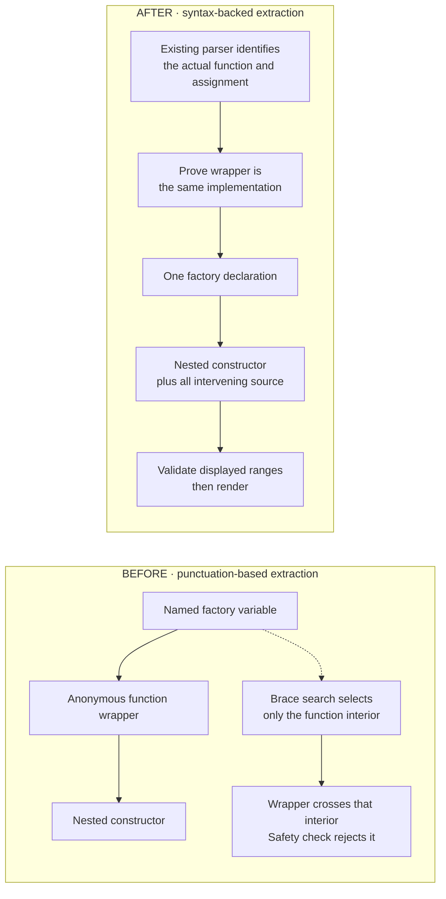
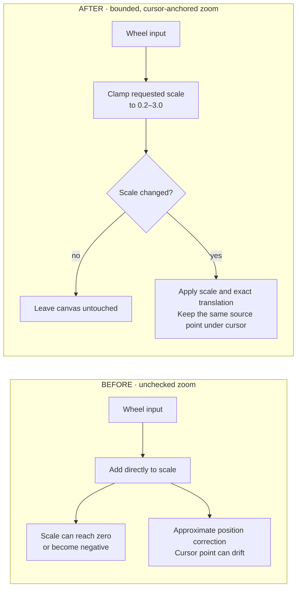
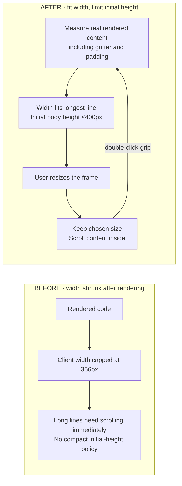
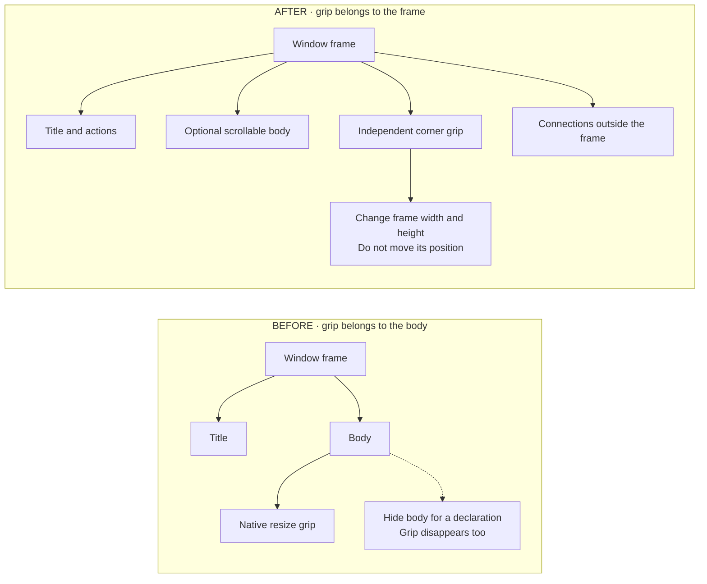
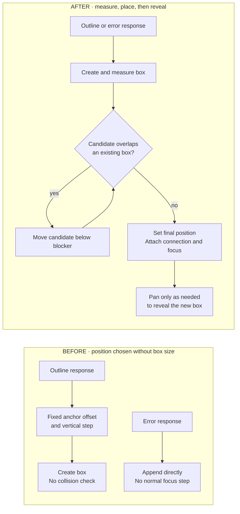
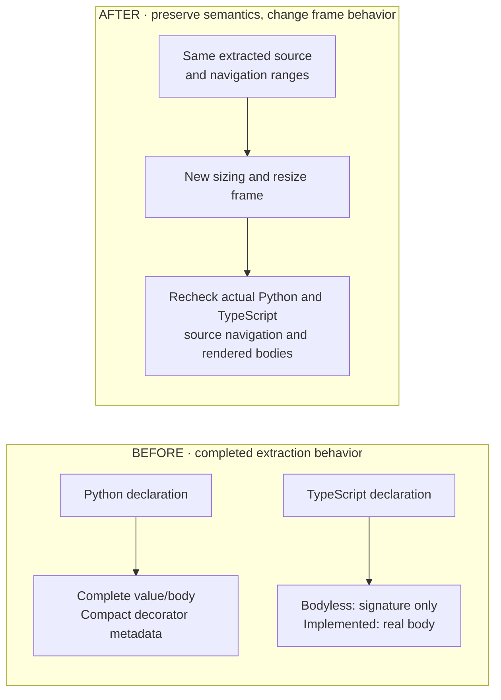

# Finish Phase 1 Group A

## Goal

Finish Group A, including the new JavaScript constructor bug **R19**. Keep the working declaration fixes; make boxes readable, resizable, and easy to find.

<details>
<summary>Evidence behind these approaches</summary>

- JavaScript currently uses `VpLspExtenderCurlyBraces`, not the parser-backed TypeScript adapter. The brace adapter searches for the next `{`/`;` and derives the body end from the provider range. The TypeScript adapter already has local parsing, source-coordinate mapping, and a per-document fragment cache to reuse.
- `OutlineUtils._provideOutlineForRange()` rejects displayed children crossing the body boundary or overlapping an earlier child. Keep that safety rule. The reported R19 error is confirmed by the user; its precise provider-range cause is not yet observed in a live host.
- Read-only execution of bundled TypeScript 3.9.10's `getNavigationTree()` on the actual file found `VgfWindowTitled` `(8,6)→(150,2)` containing `<function>` `(8,25)→(150,1)`, which contains `constructor` `(22,21)→(52,3)`; coordinates are zero-based. The constructor's `nameSpan` points to the assignment target before its function-expression span. This is observed compiler navigation data, not a claim that the installed VS Code provider returns identical `DocumentSymbol` ranges.
- `VpwOutlineWindow` caps initial client width at 356px. `VgfWindowTitled` puts native resizing on the client area, which declaration-only rendering hides.
- Dockers are children placed outside their target frame. Outer native `resize`/`overflow:auto` would clip them; use an outer grip and inner scroll viewport. Existing outer ResizeObserver notifications already update docking/connections.
- `VgfExpandableWithTitle` is constructed only by titled windows. The navigation area's wheel listeners currently pan the world and prevent native scrolling, so the new inner scroll viewport needs event isolation.
- Error cards use `vp_widget_add()` rather than the outlines' focused `vp_addWindow()` path. Fixed-step placement does not inspect node dimensions or collisions.
- Source changes belong in `src/web_visualizer/src/` and `src/vscodeextension/src/`; regenerate outputs through the build. Keep `specs/` read-only. No language servers are configured; use scoped caller searches unless a server becomes available.
</details>


## Approach

Before editing source, copy this approved plan to `features/phase-one-group-a/plan.md`. Complete the R19 source-boundary fix before changing the same JavaScript window-constructor file for sizing. Zoom work is independent; placement depends on completed sizing.

### 0. Correct JavaScript function-expression boundaries — R19

**Before:** current extraction code and the bundled compiler's symbol tree. Exact live-provider ranges still need capture.



**Why this after**
- Parentheses create another provider symbol, not another implementation to display. Collapse only a wrapper whose source range matches the parsed function exactly; keep its children.
- Syntax also identifies the assignment target, so `self.constructor =` belongs to the heading rather than being duplicated in surrounding text.
- Reuse the bundled parser instead of adding another parser. Keep the safety check: unrelated overlaps still fail. The cost is a narrow JavaScript extension to the shared extraction contract.

<details>
<summary>Exact extraction edits</summary>


Reuse the bundled TypeScript parser and its existing fragment cache. Do not fix this by catching the partition error, ignoring crossing children, changing the source into another coding style, or introducing a second JavaScript parser.

**Shared contract**

In `src/vscodeextension/src/outlineproviderAPI/lspextenderprovider.ts`, add:

```ts
// LanguageSpecificSymbolInformation
children?: readonly vscode.DocumentSymbol[];

// VpLspExtenderProvider
isDeclarationSymbol?(
  document: vscode.TextDocument,
  symbol: vscode.DocumentSymbol,
  context?: SymbolExtractionContext
): boolean;
```

- `children` is an optional display-child projection, not a replacement provider tree. An absent field uses `docSymbol.children`; an empty array means no displayed children. Preserve the original symbol objects, ranges, and arrays.
- `isDeclarationSymbol` can opt a variable/constant/property/field into declaration rendering. Missing hook/false keeps today's ordinary-source behavior. The parser-backed adapter enables this only for JavaScript callable initializers/assignments, not Python or TypeScript.
- In `OutlineUtils._provideOutlineForRange()`, consult that hook only for those four currently ignored kinds. Reuse supplied ancestor context and parser cache. Other ignore rules remain unchanged.
- In `documentSymbol2outlineSymbol()`, pass `information.children ?? docSymbol.children` to partitioning and establish parent context for projected children before recursion. Build each included child outline once, then use its effective `totalRange` for sorting, guard checks, source-gap boundaries, and advancing the cursor. Keep the same strict crossing/overlap predicate and error; apply it to the ranges actually displayed. Do not bypass the guard for function wrappers.
- Keep the current disjoint-child skip. Before recursive extraction, preflight included raw children with the existing containment/duplicate/crossing checks, after the adapter has removed only a certified transparent wrapper. After extraction, validate effective ranges again before adding text. This preserves the existing safety-error behavior for corrupt raw ranges and also prevents an expanded assignment from duplicating preceding text.

**Parser and provider**

- Extend `VpLspExtenderTypeScript`'s constructor language union with `'javascript'`; use `ScriptKind.JS` and a `.js` fragment for that language. Keep TS/TSX parse modes and behavior. Register JavaScript with this adapter in `providerregistrer.ts` instead of the generic brace adapter; the TypeScript name identifies the reused compiler implementation. Factor the existing parse/cache/selection work into a private helper shared by extraction and `isDeclarationSymbol`, rather than parsing the same fragment twice.
- Resolve parenthesized callable initializers and assignment-function declarations from syntax, including `const VgfWindowTitled = (function() { ... });`, `self.constructor = function() { ... }`, and the bare-identifier function assignments in that same file. Permit only `=` assignments to identifier/property/element targets; do not treat arbitrary expressions or calls as declarations.
- A callable heading starts at its binding/assignment target and stops before the callable body: `VgfWindowTitled = (function()` and `self.constructor = function()` in the reproduction. Body ranges cover the actual block interior (or arrow expression), excluding the wrapper's closing `});`. Preserve source whitespace and coordinates.
- Prefer raw JS expression/statement parsing before the existing symbol-kind wrappers: `self.constructor = function()` must not become a fabricated class method or `const self.constructor`. Anonymous function-only fragments use a temporary expression wrapper. Reuse supplied ancestor syntax when a provider range contains only the right-hand function expression.
- Match a binding/assignment by its exact AST target selection (including the terminal property identifier) or declaration start. For a provider symbol pointing at only the RHS function, require AST identity with that function and an unambiguous assignment ancestor. Use the existing `rangeDeclaration` field for the mapped full assignment expression when its target lies outside the raw range; update that field's Python-only comment to describe both syntax-backed cases. No line-prefix scan or nearest-name guessing. With no suitable cached/supplied ancestor, reject this incomplete form explicitly.
- Preserve raw provider objects. A full declaration range stays the `totalRange`; only the certified RHS-only case expands to the containing assignment. If its selection lies outside the RHS span, allow it only after confirming that exact assignment target in the ancestor AST; retain strict validation for every other range/selection.
- If an immediate provider child represents exactly the same initializer function already used as this declaration's implementation, replace that one wrapper in `children` with its children. Certification requires equality with a mapped AST function-expression range (or a parenthesized-expression node on the same initializer chain), not its name or mere range containment. Preserve all other children and let the unchanged guard reject invalid crossings/duplicates. A second matching wrapper is invalid, not silently deduplicated.
- Non-callable locals such as `self`, `container`, and `expandible` stay in ordinary source gaps. Callable descendants remain navigable declarations. Do not promote class expressions or add JavaScript React support in this task. Malformed selected syntax and ambiguous matches keep explicit extraction errors.

</details>

### 1. Bound zoom without coordinate drift — R11



**Why this after**
- Positive bounds prevent collapse and reversal at their cause; they do not hide a broken transform.
- No translation at the limit means continued scrolling cannot push the canvas away.
- Position correction uses the actual old/new scales, so zooming does not break pointer coordinates. The chosen bounds trade extreme magnification for predictable interaction; no new controls are needed.

<details>
<summary>Exact zoom edits</summary>


In `src/web_visualizer/src/vgf/vgf_navigationarea.js`, retain `zoom(mouseevent, scalingObject)` and the existing Ctrl-only/Alt-only modifier rules.

- Set `MIN_SCALE = 0.2` and `MAX_SCALE = 3`. Compute `newScale = Math.max(MIN_SCALE, Math.min(MAX_SCALE, oldScale - e.deltaY * 0.001))`. Keep the current effective wheel sensitivity; remove the dead `delteMode` branches rather than introducing a new sensitivity policy. Ignore a non-finite delta.
- Clamp before calling `node_scale`. If the clamped value equals the old value, return without changing scale or translation.
- Replace the current `1 + scaleAmount` approximation. Before scaling, save the world coordinate under `(e.clientX, e.clientY)` using `(cursor - oldRect.origin) / oldScale`. After setting `vp_scale` and calling `node_scale`, get the new rect; adjust the existing CSS left/top by `cursor - (newRect.origin + savedWorldCoordinate * newScale)`. This accounts for the actual transform origin and the navigation area's screen offset.
- Reuse `node_scale` from `src/web_visualizer/src/utils/std.js`; keep the initial `VgfWorld.vp_scale = 1`. Do not change `_Mover`, popup coordinate APIs, or add zoom controls.

</details>

### 2. Fit width, constrain initial height, and resize every box — R15/R18

**Sizing**



**Why this after**
- DOM measurement includes line numbers, tabs, fonts, and padding; character counting would only approximate the required width.
- Width and height serve different needs: show complete lines initially, but avoid a tall function taking over the canvas.
- The height limit applies only to initial sizing/auto-fit. Manual resizing remains unrestricted above the minimum. Very wide lines deliberately produce very wide boxes, as requested.

**Resize ownership**



**Why this after**
- Resize is a window operation, not a code-body operation. Moving ownership gives declarations, empty methods, files, and errors the same control.
- A custom frame grip is needed because native frame scrolling would clip connection handles outside the frame. Only the inner viewport clips/scrolls content.
- Flex layout lets the viewport shrink while the title and grip remain available. This changes shared window layout, so collapse/expand and attached edges need regression checks.

<details>
<summary>Exact sizing, layout, and resize edits</summary>


Use one sizing implementation in `VgfWindowTitled` for outlines, files, empty implementations, signature-only declarations, and messages. No equivalent outer-frame resize/fit implementation exists; the current body-only native resize cannot serve signature-only windows.

**Layout and scroll ownership**

1. In `src/web_visualizer/src/vgf/vgf_expandable_with_title.js`, replace the title/content table with a flex-column widget containing a flex title row and the existing `vp_content`. Keep `vp_title`, `vp_content`, `vp_appendTitle`, `vp_appendContent`, `_vp_button_expand`, and `vp_expand` contracts. Use `.VgfExpandableTitleRow`, `.VgfExpandableToggle`, and `.VgfExpandableTitle` for the row, toggle holder, and title holder; migrate the old `.td_expanderButton` CSS in `vgf_expandable_with_title.css`. There is only one constructor caller, in `vgf_window_tiled.js`.
2. In `vgf_window_tiled.js`/`.css`, retain the expandable instance as `self._vp_expandable`. Make `.Window_OuterFrame` a border-box frame with visible overflow, a flex-column `.Window_InnerFrame`, and a shrinkable flex-column expandable. Set `min-width:0`/`min-height:0` on the shrinking inner containers. Keep the title row outside scrolling body content.
3. Make `.VgfExpandableContent` the single body scroll viewport (`overflow:auto`, `flex:1`, `min-width:0`, `min-height:0`, `scrollbar-gutter:stable`). Restrict these sizing rules to titled windows. Remove `.resizable` and the client-area double-click size-reset handler from `_create_content_area()`. Remove its now-unused rule in `src/web_visualizer/src/vgf/std.css` after confirming no remaining class consumer.
4. In `vpw_code_editor.css`, replace the percentage width with intrinsic `width:max-content` and a minimum width filling the body minus its margins. Keep original source whitespace and CSS-generated line numbers; remove editor-local scrolling so the body viewport owns both axes. Give the title text a horizontal scroll surface when manually narrowed, without moving close/collapse buttons or overflowing metadata. Do not change source spans/text or `SelectionUtils` offsets.
5. On body/title scroll surfaces, stop propagation of ordinary and Shift-wheel events, without preventing their native scrolling. Let Ctrl/Alt zoom events bubble. On descendant scroll (capture listener on the titled window), emit the existing `vp_windowMoved` event so source connections track their scrolled origin. Keep existing connection docking and origin semantics; R16 token-end anchors are not part of this change.

**Initial sizing and explicit auto-fit**

6. Add `self.vp_fitToContent = function()` in `VgfWindowTitled`. It runs only after attachment to the themed world. Measure the real rendered DOM, not character counts, source-string lengths, or transformed screen width:
   - Temporarily clear explicit width/height, set outer width to `max-content`, and constrain the body viewport to `max-height:400px`. Include title/declaration-row widths as well as code, so controls and signatures fit.
   - Read the outer `offsetWidth`/`offsetHeight` after layout and materialize rounded-up pixel dimensions. Intrinsic measurement includes syntax spans, tabs, line-number pseudo-elements, margins, padding, borders, and the stable vertical-scrollbar gutter.
   - Remove the temporary body max-height after setting the outer height; the flex viewport now fills the chosen frame. This makes 400px an initial/auto-fit body-height limit, not a restriction on later user resizing.
   - No maximum width, including lines wider than the viewport. Short content remains naturally short. No parts/empty source/bodyless declarations size from their visible title and frame chrome.
7. Delete the 356px cap and detached measurement block in `vpw_outline_window.js:78–86`. Leave `_vp_fillClientarea()`'s `declarationOnly` early return/body hiding intact. Do not add status text, a badge, or synthetic body source.
8. Call `vp_fitToContent()` in both `VpwWorld.visualizeOutline()` and `visualizeMessageBox()` immediately after world attachment, before returning to the controller. Change messages to use `vp_addWindow()` like outlines, so both receive normal foreground focus. No repeated fitting on ResizeObserver notifications, connection creation, ordinary focus, panning, or zoom; those must preserve user size.

**Body-independent resize control**

9. Add a `.Window_ResizeHandle` directly to the titled outer frame, separate from title and body. Use a visible 14×14px bottom-right grip, `cursor:nwse-resize`, and `touch-action:none`. Reserve a 14px bottom frame strip so content/scrollbars cannot cover the handle. Outer overflow must remain visible: docked connection buttons are children positioned outside the frame.
10. On primary-button `pointerdown`, prevent default and stop propagation, focus the window, capture the pointer, and record starting client coordinates, outer world-pixel size, and current positive world scale. On `pointermove`, apply `startSize + pointerDelta / scale` to outer border-box width/height. Never change left/top or call `vp_startMoving`. Minimum width is 120px; minimum height is the current title-row height plus borders and the grip strip. Use no maximum width/height.
11. End resize on `pointerup`, `pointercancel`, `lostpointercapture`, or `vp_beforeDelete`; release capture when held and discard drag state. Stop the handle's `mousedown` as well so legacy mouse drag handlers cannot activate. Continue using `VgfWindow`'s existing ResizeObserver and docking/connection listeners; do not introduce a second resize event.
12. Double-clicking the grip invokes `vp_fitToContent()` and resets explicit user sizing to the initial-fit policy. Title it `Drag to resize; double-click to fit content`. Remove the old anywhere-in-body auto-fit behavior so double-click source navigation does not unexpectedly resize the window.
13. Collapse saves the expanded pixel height and shrinks to title plus grip; expansion restores that height. Width remains unchanged. Resizing while collapsed affects its collapsed frame, not the saved expanded height. Auto-fit while collapsed measures the expanded content synchronously, stores the resulting expanded height, then restores the collapsed presentation. For declaration-only windows, the client stays hidden in both states.

</details>

### 3. Place measured new nodes without overlap — R13



**Why this after**
- Placement needs the final size; a fixed step cannot accommodate long lines or tall boxes.
- Moving only the new candidate preserves the user's existing layout. The downward search is simple and deterministic, but can make a column tall.
- Foreground focus alone does not prevent overlap, and collision avoidance alone can place a node offscreen. Both placement and minimal viewport reveal are needed.
- Errors use the same path rather than a permanent always-on-top layer. Oversized boxes keep their full width; reveal their beginning instead of shrinking them.

<details>
<summary>Exact placement and foreground edits</summary>


In `src/web_visualizer/src/vp/window_positioner.js`, replace fixed 100px vertical stepping with measured placement. Reuse `Direction.LEFT/RIGHT`; no graph rearrangement, z-index tiers, or edge-routing redesign.

1. Keep the constructor `WindowPositioner(parentOfTarget, domAnchor_nullable, anchorOffsetLocation = Direction.RIGHT)`. Store world, anchor, direction, and next batch Y. Replace `getX/getY/moveX/moveY` with `placeWindow(managedWindow)`, returning `{x, y}`, plus `revealWindow(managedWindow)`. The only external users of the old positioning methods are in `Controller._visualizeOutline`; migrate that method and remove obsolete fields/methods.
2. Keep geometry helpers private to `window_positioner.js`. Use `(elementRect.left/top - worldRect.left/top) / world.vp_scale` for world coordinates and `offsetWidth/offsetHeight` for dimensions. Obtain viewport coordinates from `world.parentElement.getBoundingClientRect()`. Do not use the old `getOffset()`/negated `world.offsetLeft` mixture or a fallback scale.
3. For an attached anchor, resolve its enclosing `.Window_OuterFrame`. Place RIGHT at the source frame's right edge +50 world px; LEFT at its left edge −50 −new width. Align Y with the anchor's top, clamped inside the source frame. If the attached anchor has no enclosing frame, use the anchor's own box. A missing/detached anchor uses viewport-world left +50 and top +100. A deleted requestee must not be passed into connection creation.
4. Snapshot visible direct-child `.Window_OuterFrame` bounds, excluding the new window. Include outlines, files, and message/error cards; exclude popups, dockers, and line widgets. At the candidate X/Y, require 24 world px clearance on both axes from each existing frame. If overlaps exist, move Y to the largest overlapping bottom +24 and scan again. Y only advances; with finite existing nodes this terminates below all blockers. No arbitrary attempt limit or overlapping cascade fallback. Existing nodes never move.
5. Advance the positioner's next batch Y to the placed node's bottom +24; each subsequent new node is measured and checked against earlier nodes in the same response. Existing-node reuse only focuses/connects and never repositions or auto-fits that node.
6. In `Controller._visualizeOutline`, create each missing node with `_managedWindow_create(requestMessage, outlineEntity, 0, 0)`; the world factory attaches/fits it. Then call `placeWindow`, apply its result with `vp_setXY`, and only then create connections. Remove the unconditional `moveY()`. Do not connect to an anchor that is no longer contained in this world.
7. After the response batch, call `revealWindow` for the last newly created node. Translate the world, not individual nodes, by the smallest screen-pixel delta that puts its rect inside the navigation viewport with a 20px inset. If a node is wider/taller than that available viewport dimension, align its left/top edge at that inset instead of shrinking it. Do not change zoom. This exposes a useful starting portion of oversized full-line boxes and prevents collision avoidance from leaving new nodes entirely offscreen.
8. Reuse `vp_addWindow()`/`vp_focus()` and the existing `zIndexManager` for foreground ordering. The message-factory fix in step 2 closes its missing-focus path; error cards do not get a permanent always-on-top tier.

</details>

### 4. Preserve completed extraction outcomes — R04/R10



**Why this after**
- R04/R10 already have completed fixes; replacing them would add risk without delivering another requested outcome.
- The shared parser/layout changes can still cause regressions. Verify the same source and body states in the real extension rather than assuming prior test results cover the new frame.

<details>
<summary>Preservation requirements</summary>


Preserve Python name-only assignment expansion, compact decorator metadata, and TypeScript signature/body behavior from `features/declaration-boundaries/results.md`. The R19 work extends the parser adapter and child partitioning only through step 0; it must not change Python extraction or weaken invalid-range rejection. Use the existing Python/TypeScript boundary fixtures and real-provider UI checks to verify complete source and navigation after the canvas changes.

</details>

## Verification

<details>
<summary>Behavior checks, exact commands, and implementation anchors</summary>


### Prerequisites and build

All commands start at the repository root unless stated otherwise. Planning confirmed the installed VS Code executable and local `tsc`/`eslint` executables exist; it did not run builds or UI scenarios. Python/Pylance availability must be checked in the development host.

1. Treat user-reported failures as established. Before changing `vgf_window_tiled.js`, capture its actual document-symbol ranges, selection ranges, child tree, and extraction boundaries to diagnose R19; do not rerun the failed visualization merely to confirm the report. Inspect the existing browser layout for baseline measurements.
2. After implementation, run `npm run build:ext` once; inspect the JS/CSS build stages as well as TypeScript output because the existing web build uses semicolon-separated commands. This regenerates web release and extension media assets.
3. Run `npm run serve:web` as a named service. Use real Chromium at:
   - `http://localhost:8080/tests/typescript_basic_show_class_dark_theme.html`
   - `http://localhost:8080/tests/typescript_basic_show_class_light_theme.html`
   - `http://localhost:8080/tests/basic_case_show_messageboxes_dark_theme.html`
   - `http://localhost:8080/tests/basic_case_show_messageboxes_light_theme.html`
4. Use existing `window_postRequest(type, rqId, data)`, `gTestdata_outlineData`, and controller requests for throwaway browser scenarios. No new UI testing dependency or source-text assertions. Extend no permanent suite solely to assert DOM wiring.

### R19 regression checks

Add `src/vscodeextension/src/test/suite/outlineprovider_test/javascript_function_expression_boundaries.test.ts` using the existing `MemoryFile`, `DocumentSymbolX`, `AssertX`, and `OutlineUtils` test pattern. This new file is behavioral coverage for the reported defect, not a separate test framework.

Use a compact source fixture with this structure; never execute it:

```js
const Factory = (function() {
  let self = makeWindow();
  self.constructor = function() {
    { let container = makeContainer(); use(container); }
    return self;
  };
  helper = function() { return 1; };
  return self;
});
afterFactory();
function later() { return 2; }
```

Check:

- File outline exposes `Factory` as a declaration despite its provider Variable/Constant kind. Its heading is `Factory = (function()`; its body contains `self`, `constructor`, `helper`, and the final return, never `afterFactory()` or `later`.
- For a provider tree with the exact anonymous initializer wrapper, the factory directly exposes `self.constructor` and `helper`; the redundant wrapper is not a second box. For a tree already flattened by the provider, keep those direct children unchanged.
- Both complete-assignment and RHS-only function ranges produce heading `self.constructor = function()` and the complete nested-block body. The RHS-only case uses the syntax-backed assignment range, and parent text does not duplicate `self.constructor =`.
- Compare source slices of each Text part and each child Symbol's effective totalRange. In source order, they exactly reconstruct the extracted parent body, excluding only the existing intentionally omitted whitespace-only parts. Original provider ranges, order, and child arrays remain unchanged.
- Cover extra parentheses, braces/semicolons inside strings/comments, empty function bodies, a malformed selected callable, and an unrelated reference selection. Add a wrapper with an unrelated enclosing range and duplicate/crossing real children: those must still fail, not be flattened or deduplicated.
- Keep the existing overlap rejection cases in `outline_partition.test.ts`; run the full existing Python/TypeScript/shared suite plus the new JS suite in the installed development host. Only the targeted syntax-backed JavaScript ranges may expand.


### Browser acceptance matrix

Use real pointer drags/wheel events and screenshots in both themes. DOM geometry measurements supplement visual proof; wait for the existing docking animation/ResizeObserver to settle before reading endpoints.

| Item | Concrete scenario | Required observation |
|---|---|---|
| R11 | Ctrl-wheel and Alt-wheel beyond both bounds, then reverse direction; include large deltas and a viewport offset from page origin | Scale stays in `[0.2, 3]`. Extra input at either bound changes neither scale nor translation; reverse input responds immediately. The same world point stays under the cursor within 1 screen px. |
| R11/R18 | At scales 0.2, 1, and 3 after panning, drag a title, open its context menu, then drag its resize grip | Correct positive drag/resize directions and coordinate conversion; menus appear at the pointer. A 60px screen resize changes dimensions by 300, 60, and 20 world px respectively, unless hitting the minimum. |
| R15 | Inject a source-backed outline with 120 lines, tabs, a long argument line, nested-dictionary text, and a 2,000-character string line; include a final `END_OF_SOURCE` sentinel | Initial width contains the complete longest rendered line plus gutter/padding; no forced wrapping, clipping, or 356px cap. Body viewport height ≤400 world px; vertical scrolling reaches the sentinel. An over-viewport-width node remains wide rather than being capped. |
| R15 | Narrow and shorten that node, scroll to both source ends, then double-click its grip | Horizontal/vertical scrolling reaches all unchanged source. Ordinary/Shift-wheel scrolls the node without panning the world; Ctrl/Alt still zooms. Auto-fit restores full-line width and the initial height policy. Source double-click navigation no longer invokes auto-fit. |
| R18/R10 | Open `DeclarationExamples.read`, `run`, and `empty`; also a file, a long code node, and an error card | Each has one accessible grip. Drag changes width/height but not left/top; minimum dimensions retain controls. `read` stays signature-only with no body/editor/status; `run` keeps `return \"implemented\";`; `empty` does not gain fake source. |
| R18 | Resize connected nodes, scroll connected source, collapse/expand, cancel a grip drag, then close a node during a drag | Dockers/edges remain visible and attached; no clipping from outer overflow. Expanded height and manual width survive collapse. No stuck pointer capture, continued resizing, or accidental node movement. |
| R13 | Crowd the preferred slot with tall/wide nodes; open multiple connected nodes, LEFT/Open parent nodes, and errors, then repeat at 0.2 and 3 after a 400px pan | New outer bounds do not overlap any existing frame, including siblings from the same response. LEFT placement accounts for target width. New error cards are focused. The last new node's top-left/usable content is revealed; existing world positions remain unchanged. |
| R13 | Request an existing node, send a multi-entity response, and delete a requestee before its response | Existing node is reused without changing size/position. Batch nodes use actual heights. A late response gets an unanchored visible slot without a connection to detached DOM. |

For the source-backed long fixture, build `content`, `contentLineBuffer`, and `displayTextRange` from the same text. Select a known identifier after horizontal/vertical scrolling and inspect the `outline_requestByFilePosition` message: line/character must still match that source text. Do not reuse inconsistent ranges from historical mock entries.

### Real VS Code integration and R04/R10 regression proof

Use the installed current VS Code host, not the known-failing legacy 1.61.1 downloader. From the root:

```sh
env VSCODE_CLI=1 '/Applications/Visual Studio Code.app/Contents/MacOS/Code' \
  --new-window --user-data-dir=/tmp/scv-group-a-tests \
  --disable-extension=vscodevim.vim \
  --extensionDevelopmentPath="$PWD/src/vscodeextension" \
  --extensionTestsPath="$PWD/src/vscodeextension/out/test/suite/index" \
  --skip-welcome --skip-release-notes --disable-workspace-trust \
  "$PWD/src/vscodeextension/src/test/testfiles"
```

The current suite activates `visualprogrammingx.SourceCodeVisualizer-Local`, Python, and Pylance. Run the existing full suite; record the actual result, not the historical 104-pass count. Launch a separate UI host for real-file verification:

```sh
env VSCODE_CLI=1 '/Applications/Visual Studio Code.app/Contents/MacOS/Code' \
  --new-window --user-data-dir=/tmp/scv-group-a-live \
  --disable-extension=vscodevim.vim \
  --extensionDevelopmentPath="$PWD/src/vscodeextension" \
  --remote-debugging-port=9333 \
  --skip-welcome --skip-release-notes --disable-workspace-trust \
  "$PWD/../../MAFC/Workspace/airflow-data/dags"
```

- Use the `(Local)` commands `code-visualizerzer-local.visualizeFile` and `code-visualizerzer-local.visualize`, not the old upstream command IDs. Attach browser tools to the actual workbench/webview via CDP for DOM inspection and screenshots; use the real UI for commands and pointer actions.
- Open `../../MAFC/Workspace/airflow-data/dags/ingestion/table_level/trino_ingestion_dag_factory.py` as source only. Never execute, import, save, or modify it.
- Visualize file → `_build_dag` → nested `ingestion_dag`. Inspect all three rendered headings, compact decorator metadata/full hover text, and body text. Verify the complete `operators.OracleToIcebergIngestionOperator(...)` argument lines at initial fit and after narrowing/scrolling. Exercise zoom bounds, new-node placement, and resizing here, not only in mocks.
- Open `CONFIG_DIR`, `TRINO_CONN_ID`, `DAG_TIMEZONE`, `IDENTIFIER_KEYS`, `REQUIRED_KEYS`, `OPTIONAL_KEYS`, `ALLOWED_KEYS`, and `SQL_TASK_TIMEOUT`. Each value remains complete without neighboring declaration leakage. **Show in code** on `ingestion_dag` and `REQUIRED_KEYS` must select the actual source declaration; current fixture coordinates are zero-based `(195,8)` and `(27,0)`, respectively.
- Open existing `src/vscodeextension/src/test/testfiles/python/declaration_boundaries.py`: `limit`, multiline `config`, `build`, and `later` exclude adjacent `AFTER` statements. Python `pass`, ellipsis, and docstring bodies remain source.
- Open existing `src/vscodeextension/src/test/testfiles/typescript/declaration_boundaries.ts`: `Reader.read` and `Base.run` stay signature-only and resizable; `Worker.read` displays its implementation; `Worker.empty` stays empty and resizable. Check `limit`/`config` exclude adjacent `AFTER` statements. Exercise **Show in code** after resizing.
- R19: in the live host, open the repository's actual `src/web_visualizer/src/vgf/vgf_window_tiled.js` → `VgfWindowTitled` → nested `self.constructor`. Inspect headings, full bodies, nested declaration rows, intervening source, and connections. **Show in code** at both function levels must target the corresponding declaration in that file; determine positions from the current source, since the sizing changes edit this file. No duplicated text, skipped valid children, neighboring declaration leakage, or suppressed safety error.
- Completion requires browser and live-host evidence for all seven Group A IDs: R04, R19, R10, R11, R13, R15, R18. Record observed commands, geometry, navigation results, screenshots, and limitations in `features/phase-one-group-a/results.md` only after implementation and validation finish.

## Critical files and anchors

- `src/web_visualizer/src/vgf/vgf_dockable.js`, `vp_dock`: dockers are appended to their targets at negative X; outer-frame clipping would hide them.
- `src/web_visualizer/src/vpw/vpw_entity_connection.js`, `_VpwEntityConnectionSpecialLine._initEventListeners`: existing move/resize events update edges; reuse them for new scroll surfaces.
- `src/web_visualizer/src/vgf/vgf_window.js`, `_vp_initResizeEvent`: existing outer ResizeObserver supplies resize notifications; do not duplicate it or refit in its callback.
- `src/vscodeextension/src/test/suite/index.ts`, `Extensions.activate_visualProgramming`: integration suite uses the renamed local extension identity.

## Assumptions and contingencies

- Full-line width without a cap and later manual resizing are user requirements. The chosen ordinary initial height is a maximum 400px body viewport; this is not a full-source-height fit.
- Zoom bounds of 20–300%, 24px collision clearance, and minimal viewport reveal are implementation defaults. There are no new settings or controls beyond the required resize grip and its auto-fit gesture.
- If Python/Pylance are unavailable in the isolated host, check the installed extensions and use the existing installed extension directory with `--extensions-dir`; do not substitute mock output for live verification. If unavailable there too, report that exact prerequisite and do not mark Group A complete.
- If port 8080 or 9333 is occupied, select a free local port and use it consistently in the service/browser connection; do not stop an unrelated process.
- If intrinsic layout measurement undercounts because a descendant still constrains width, remove that constraint within the titled window/code viewport and remeasure actual DOM; do not switch to character-count estimates or add a clipping cap.

</details>
